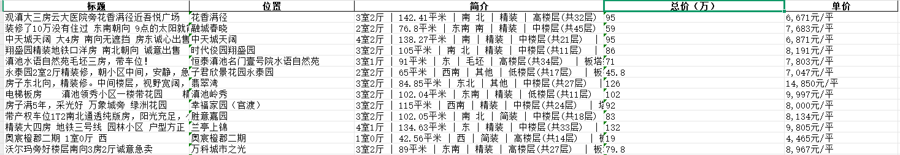
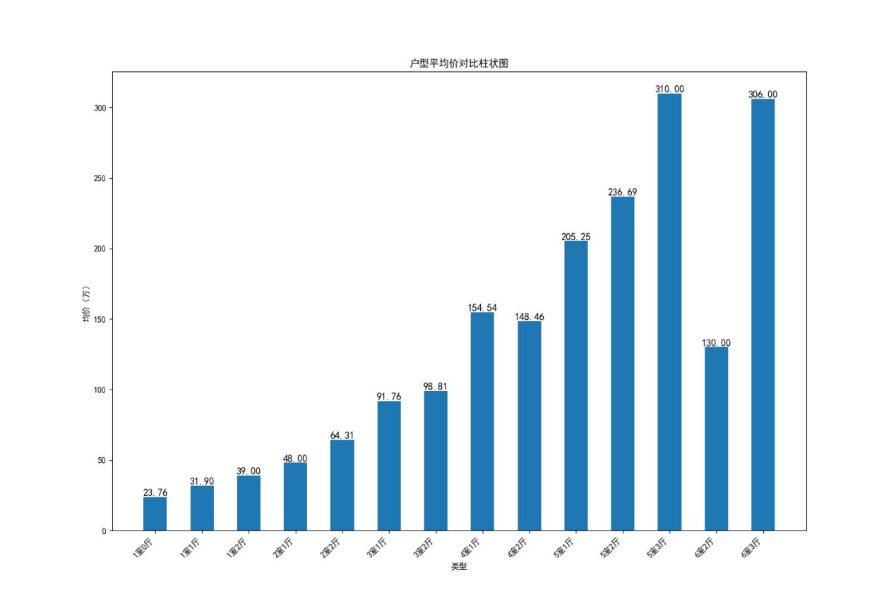

# 基于网络爬虫的链家房地产市场分析

基于 Python 网络爬虫对链家（昆明）二手房公开数据进行采集、分析与可视化的课程项目。

> 原始报告见 [房地产市场分析.docx](./房地产市场分析.docx)，本文为报告的 Markdown 版，便于在 GitHub 上直接阅读。

## 项目简介

### 研究背景

随着房地产市场的快速发展，消费者对信息透明度和交易效率的需求日益提升。链家作为国内领先的房地产服务平台，其线上房源数据、交易动态及市场策略对行业具有重要参考价值。

基于网络爬虫技术，可系统化采集链家公开数据，分析市场供需结构、价格波动及政策影响，为购房者、投资者及行业从业者提供决策支持。

### 研究意义

本研究通过爬取链家房地产数据，可深入挖掘市场动态与价格趋势：

- 为消费者提供精准的购房参考，降低信息不对称风险；
- 为投资者揭示潜在投资机会，优化资产配置；
- 为政策制定者提供数据支撑，辅助调控市场；
- 推动房地产行业数字化转型，提升市场透明度与运行效率。

## 技术栈

| 用途 | 技术 |
|---|---|
| HTTP 请求 | `requests` |
| HTML 解析 | `lxml`（`etree` + XPath） |
| 数据存储 | `pandas`（导出 Excel） |
| 中文分词 | `jieba` |
| 可视化 | `matplotlib`、`wordcloud` |

## 数据获取

目标站点：`https://km.lianjia.com/ershoufang/pg{page_num}/`（链家昆明二手房列表页）。

爬虫类 `LianJiaSpider` 的主要方法如下：

1. **初始化（`__init__`）**：配置完整 HTTP 请求头（`User-Agent` 模拟 Chrome、`Referer`、`Accept-Language` 等）与 Cookie；初始化 5 个空列表用于存储数据——`titles`（标题）、`didians`（位置）、`jianjies`（简介）、`zongjias`（总价/万元）、`danjias`（单价）。

2. **单页爬取（`crawl_page`）**：设置 0.5 秒请求间隔避免请求过于频繁；构造目标 URL、发送 GET 请求；用 `lxml.etree` 解析 HTML；通过 XPath 定位房源信息块（`/html/body/div[4]/div[1]/ul/li/div[1]`），逐块提取标题、位置、简介、总价、单价；捕获索引错误等异常，保证爬虫持续运行。

3. **批量爬取（`crawl_all_pages`）**：循环调用 `crawl_page`，爬取从 `start_page`（默认 1）到 `end_page`（默认 30）的所有页面。

4. **数据保存（`save_to_excel`）**：将 5 个列表组合成字典，用 `pandas` 创建 `DataFrame`，`to_excel` 保存为 Excel 文件（默认 `./链家二手房.xlsx`，UTF-8 编码，不含索引）。

5. **主程序入口**：创建 `LianJiaSpider` 实例 → 爬取 1–30 页 → 保存 Excel。



## 数据分析与可视化

### 标题词云图

用 `matplotlib` 与 `jieba` 绘制标题词云：


- **核心业务**：「出售」「精装修」「房子」「诚心」等词突出，表明房屋出售信息、装修状态与卖家诚意。
- **房屋属性**：「精装修」「两室」「三房」等反映装修程度与户型结构。
- **楼层位置**：「楼层」「端头」体现房屋位置特点（端头房采光、通风更佳）。
- **朝向**：「南向」房屋采光好、舒适度高。
- **周边配套**：「地铁口」「小区」说明交通与居住环境。
- **交易特点**：「急售」「拎包入住」体现交易紧迫性与便利性。

### 户型均价图

用 `matplotlib` 绘制户型均价图：



整体上，随着户型房间数量增加，均价总体上升。部分数据如下：

| 户型 | 均价（万元） |
|---|---|
| 1室0厅 | 23.76 |
| 1室1厅 | 31.90 |
| 2室2厅 | 64.31 |
| 3室2厅 | 98.81 |
| 5室3厅 | 310.00 |
| 6室2厅 | 130.00 |

（6室2厅均价相对较低，可能与房源较少或市场定位特殊有关。）

## 项目结构

```
房地产市场分析/
├── 房地产市场分析.docx      # 原始报告（已清理元数据）
├── README.md                # 本文件
├── .gitignore
├── LICENSE
└── images/
    ├── data-screenshot.png  # 部分爬取数据截图
    ├── wordcloud.png        # 标题词云图
    └── price-chart.png      # 户型均价图
```

## 使用说明

1. 安装依赖：

   ```bash
   pip install requests lxml pandas matplotlib jieba wordcloud
   ```

2. 运行爬虫并保存数据：

   ```python
   spider = LianJiaSpider()
   spider.crawl_all_pages(1, 30)
   spider.save_to_excel("链家二手房.xlsx")
   ```

3. 基于导出的 Excel 进行词云与均价分析、绘图。

## 免责声明

本项目仅用于学习与研究，数据来源于链家公开页面。使用前请遵守目标网站的 robots 协议与服务条款，控制请求频率，勿将数据用于商业用途。
